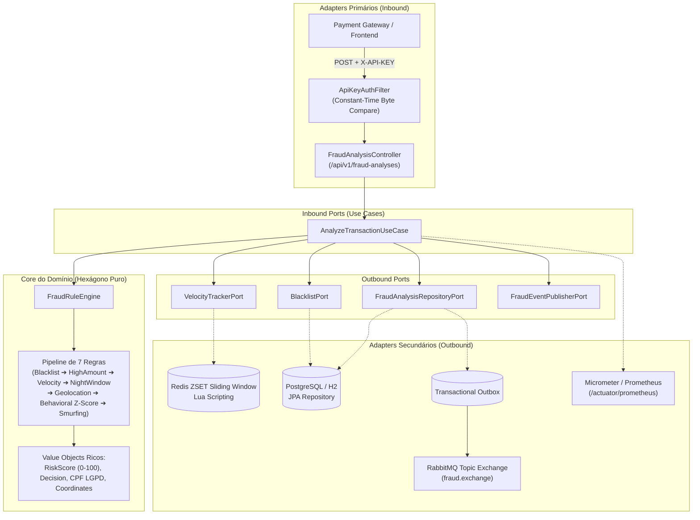

# 🛡️ Fraud Detection & Risk Engine API


[](https://github.com/FelipeGardenghiDev/fraud-detection-api/actions/workflows/ci.yml)
-success?logo=junit5)

-teal)


-175a96?logo=docker)


Uma **plataforma corporativa de alta performance** para análise preditiva de risco e prevenção a fraudes em transações financeiras (PIX, Cartão de Crédito, Débito e Boletos) em tempo real, operando com latência alvo de sub-10ms (P99 < 15ms).

Construída sobre os fundamentos de **Arquitetura Hexagonal (Ports & Adapters)**, **Java 21 LTS**, **Spring Boot 3.4**, **Project Loom (Virtual Threads)**, **Resilience4j Circuit Breaker**, **Flyway Database Migrations**, **Redis ZSET com Scripting Lua Atômico**, **Transactional Outbox Pattern**, **Testcontainers** e **Infraestrutura como Código (Terraform na AWS)**.

> 📖 **Para decisões de arquitetura e 9 ADRs formais, consulte o [Architecture Document](docs/ARCHITECTURE.md).**

---

## 🎯 Destaques Arquiteturais de Nível Staff/Senior

1. **Arquitetura Hexagonal Estrita (Ports & Adapters):**
   - O núcleo do domínio (`domain.core`, `domain.rule`, `domain.model`) é 100% isolado de qualquer dependência de Spring, JPA, Redis ou RabbitMQ.
   - Comunicação orquestrada exclusivamente por **Inbound Ports** (`AnalyzeTransactionUseCase`, `ManageBlacklistUseCase`, `ConsultMetricsUseCase`) e **Outbound Ports** (`FraudAnalysisRepositoryPort`, `BlacklistPort`, `VelocityTrackerPort`, `FraudEventPublisherPort`).
2. **Esteira de Regras Antifraude Determinística (7 Regras de Produção):**
   - Regras plugáveis via pipeline ordenado por prioridade (`@Order`), desacopladas e extensíveis.
3. **Janela Deslizante Atômica com Redis ZSET + Scripting Lua:**
   - Elimina vulnerabilidades de rajada de borda (*Border Burst*) e race conditions sem travas distribuídas lentas.
4. **Tolerância a Falhas com Resilience4j Circuit Breaker:**
   - Protege o cluster de cache: abre o circuito sob degradação e executa chaveamento instantâneo (0ms overhead) para fallback no PostgreSQL.
5. **Versionamento de Banco com Flyway Migrations:**
   - Substitui `ddl-auto: update` por scripts SQL determinísticos versionados (`V1__initial_schema.sql`) com `ddl-auto: validate`.
6. **Alta Concorrência com Java 21 Virtual Threads:**
   - I/O não-bloqueante para milhares de conexões concorrentes com overhead mínimo de memória por requisição (`spring.threads.virtual.enabled: true`).
7. **Resiliência Dual-Write com Transactional Outbox Pattern:**
   - Garante consistência atômica estrita (ACID) entre a análise persistida e o evento de alerta, imune a partições transitórias do RabbitMQ.
8. **Testes de Integração com Testcontainers (Docker):**
   - Validação com imagens reais de PostgreSQL no CI/CD com fallback inteligente (`disabledWithoutDocker = true`).
9. **Telemetria de Negócio & Observabilidade Enterprise:**
   - Exportação de métricas nativas para Prometheus (`/actuator/prometheus`) via Micrometer e diagnóstico customizado de saúde da esteira (`FraudEngineHealthIndicator`).

---

## 🧠 Esteira de Regras do Motor Antifraude (Rule Engine Pipeline)

O motor avalia a transação de forma sequencial e determinística através de 7 regras especializadas:

| Ordem | Regra | Nome Interno | Descrição e Critério de Decisão | Score |
| :---: | :--- | :--- | :--- | :---: |
| **1** | **Blacklist Restritiva** | `BLACKLIST_CHECK` | Intercepta imediatamente CPFs, IPs de rede ou Device Fingerprints com histórico de fraude confirmada. | **+100** |
| **2** | **Detecção de Valor Elevado** | `HIGH_AMOUNT_DETECTION` | Avalia valores desproporcionais: Atenção para $\ge \text{R\$} 5.000$ (+30 pts) e Crítico para $\ge \text{R\$} 20.000$ (+60 pts). | **+30 / +60** |
| **3** | **Burst de Velocidade** | `VELOCITY_BURST_CHECK` | Rastreia contagem em janela deslizante (ex: $>3$ transações em 5 min) via Redis Sorted Set. | **+40** |
| **4** | **Janela Noturna de Risco** | `NIGHT_WINDOW_RESTRICTION` | Aplica teto restritivo de R$ 1.000 entre 22h e 06h (mitigação contra coação e sequestro-relâmpago no PIX). | **+25** |
| **5** | **Deslocamento Impossível (Haversine)** | `GEOLOCATION_IMPOSSIBLE_TRAVEL` | Calcula velocidade geodésica entre transações consecutivas. Dispara se $v > 800\text{ km/h}$ para $d \ge 50\text{ km}$. | **+60** |
| **6** | **Anomalia Comportamental (Z-Score)** | `BEHAVIORAL_STATISTICAL_ANOMALY` | Modela o perfil de consumo individual do cliente. Dispara se $Z = \frac{x - \mu}{\sigma} \ge 3.0$ (3 desvios padrão acima da média). | **+40** |
| **7** | **Fracionamento (Smurfing / Structuring)** | `SMURFING_STRUCTURING_DETECTION` | Detecta tentativas deliberadas de burlar o teto regulatório de R$ 5.000 (operações entre R$ 4.500 e R$ 4.999,99 em rajada). | **+45** |

### Matriz de Decisão por Risk Score:
- **0 a 39 pontos:** `APPROVED` 🟢 (Transação legítima, processada normalmente)
- **40 a 79 pontos:** `SUSPICIOUS` 🟡 (Atenção / step-up de autenticação MFA ou fila de auditoria manual)
- **80 a 100 pontos:** `BLOCKED` 🔴 (Transação bloqueada sumariamente por alto risco de fraude)

---

## 🏛️ Diagrama Arquitetural de Alto Nível



---

## 📊 Telemetria & Métricas de Negócio (Prometheus / Micrometer)

O microsserviço expõe indicadores operacionais e financeiros em `/actuator/prometheus`:

- `fraud.analysis.duration` (**Timer**): Latência da esteira em milissegundos, com tags de veredito (`decision=APPROVED|SUSPICIOUS|BLOCKED`).
- `fraud.decisions.total` (**Counter**): Totalizador de vereditos emitidos.
- `fraud.capital.protected.amount` (**Counter**): Volume monetário (BRL) protegido contra fraudes por bloqueios.
- `fraud.idempotency.hits` (**Counter**): Total de requisições duplicadas servidas diretamente em cache em $O(1)$.

---

## ☁️ Infraestrutura como Código (Terraform na AWS)

O projeto possui especificação de infraestrutura de nuvem pronta para produção na pasta [`terraform/`](./terraform):
- **VPC & Rede Segura:** Subnets públicas exclusivas para Application Load Balancer e subnets privadas isoladas para containers e dados.
- **AWS ECS Fargate:** Orquestração de containers serverless com auto-scaling configurado por uso de CPU e memória.
- **Amazon RDS PostgreSQL Multi-AZ:** Banco relacional com alta disponibilidade, backups automáticos e criptografia KMS em repouso.
- **Amazon ElastiCache Redis:** Cache em memória gerenciado com failover automático para a janela deslizante.
- **Amazon MQ (RabbitMQ):** Cluster de mensageria gerenciado na nuvem.

> 📖 **Consulte a documentação completa de infraestrutura em [`terraform/README.md`](./terraform/README.md).**

---

## ⚡ Exemplo Prático de Requisição e Resposta

### Requisição: Análise Completa com Geolocalização
```bash
curl -X POST "http://localhost:8080/api/v1/fraud-analyses" \
  -H "Content-Type: application/json" \
  -H "X-API-KEY: fraud-secret-key-2026" \
  -d '{
    "transactionId": "TX-2026-BRA-88912",
    "customerId": "CUST-BR-4091",
    "customerCpf": "52998224725",
    "amount": 4850.00,
    "paymentMethod": "PIX",
    "ipAddress": "189.120.45.12",
    "deviceFingerprint": "fp-mac-992a10",
    "location": "São Paulo, SP",
    "latitude": -23.5505,
    "longitude": -46.6333,
    "occurredAt": "2026-10-17T01:45:00"
  }'
```

### Resposta: Diagnóstico Auditável com Breakdown de Regras
```json
{
  "analysisId": "e3b0c442-98fc-1c14-9afb-4c8996fb9242",
  "transactionId": "TX-2026-BRA-88912",
  "customerId": "CUST-BR-4091",
  "riskScore": 85,
  "decision": "BLOCKED",
  "decisionDescription": "Transação bloqueada por alto risco de fraude.",
  "idempotencyHit": false,
  "ruleBreakdown": [
    {
      "ruleName": "BLACKLIST_CHECK",
      "triggered": false,
      "scoreContribution": 0,
      "reason": "Regra não violada."
    },
    {
      "ruleName": "HIGH_AMOUNT_DETECTION",
      "triggered": false,
      "scoreContribution": 0,
      "reason": "Regra não violada."
    },
    {
      "ruleName": "VELOCITY_BURST_CHECK",
      "triggered": true,
      "scoreContribution": 40,
      "reason": "Alta velocidade transacional: 4 transações em menos de 5 minutos."
    },
    {
      "ruleName": "NIGHT_WINDOW_RESTRICTION",
      "triggered": false,
      "scoreContribution": 0,
      "reason": "Regra não violada."
    },
    {
      "ruleName": "GEOLOCATION_IMPOSSIBLE_TRAVEL",
      "triggered": false,
      "scoreContribution": 0,
      "reason": "Deslocamento plausível: 12.4 km em 0.5 h (25 km/h)."
    },
    {
      "ruleName": "BEHAVIORAL_STATISTICAL_ANOMALY",
      "triggered": false,
      "scoreContribution": 0,
      "reason": "Z-Score aceitável (1.42 < 3.00 limiar)."
    },
    {
      "ruleName": "SMURFING_STRUCTURING_DETECTION",
      "triggered": true,
      "scoreContribution": 45,
      "reason": "Padrão suspeito de fracionamento (Smurfing/Structuring): valor R$ 4850.00 imediatamente abaixo do teto de R$ 5.000,00 com 4 transações recentes na janela."
    }
  ],
  "analyzedAt": "2026-10-17T01:45:00"
}
```

---

## 🛠️ Stack Tecnológica

| Componente | Tecnologia | Papel no Sistema |
| :--- | :--- | :--- |
| **Linguagem** | Java 21 LTS | Records, Pattern Matching e Virtual Threads |
| **Framework** | Spring Boot 3.4.3 | Núcleo do microsserviço (Data JPA, Security, Actuator, Web) |
| **Padrões de Arquitetura** | Hexagonal (Ports & Adapters) + Outbox + Specification | Desacoplamento e testabilidade pura |
| **I/O & Concorrência** | Project Loom (Virtual Threads) | Despacho não-bloqueante para alto throughput |
| **Resiliência & Circuit Breaker** | Resilience4j 2.2 | Proteção de falhas e fallback automático para Redis |
| **Migrações de Banco** | Flyway 10 | Versionamento estrito e determinístico de schema SQL |
| **Cache & Sliding Window** | Redis 7 + Lua Scripting | Janela deslizante atômica com ZSET |
| **Mensageria Assíncrona** | RabbitMQ 3.13 | Publicação orientada a eventos (`FraudAlertEvent`) |
| **Persistência** | PostgreSQL 16 & H2 | H2 para suíte veloz em memória; PostgreSQL para produção |
| **Observabilidade & Health** | Micrometer + Prometheus + Actuator | Exportação de métricas, P99 e probes de saúde |
| **Infraestrutura (IaC)** | Terraform na AWS | VPC, ECS Fargate, RDS Multi-AZ, ElastiCache, Amazon MQ |
| **Qualidade & Testes** | JUnit 5 + Mockito + JaCoCo + Testcontainers | **46+ testes automatizados (100% passing)** com paridade de produção |
| **Documentação** | OpenAPI 3 / Swagger UI | Interface interativa com suporte a `X-API-KEY` |

---

## 💻 Execução Local ($0 de Custo)

### Pré-requisitos
- OpenJDK 21 ou superior
- Git

### 1. Executando Localmente (Perfil Padrão com Banco em Memória H2)
```bash
git clone https://github.com/FelipeGardenghiDev/fraud-detection-api.git
cd fraud-detection-api
./mvnw spring-boot:run
```
Swagger UI interativo: `http://localhost:8080/swagger-ui.html`

### 2. Executando com Docker Compose Completo (PostgreSQL + Redis + RabbitMQ)
```bash
docker compose up -d
```

### 3. Executando a Suíte de Testes Automatizada (44 Testes)
```bash
./mvnw clean test
```
O relatório HTML detalhado de cobertura será gerado em: `target/site/jacoco/index.html`.

---

## 👨‍💻 Autor

Desenvolvido por **[Felipe Gardenghi](https://github.com/FelipeGardenghiDev)**  
Conecte-se comigo no [LinkedIn](https://www.linkedin.com/in/felipegardenghi/) ou pelo [GitHub](https://github.com/FelipeGardenghiDev)!