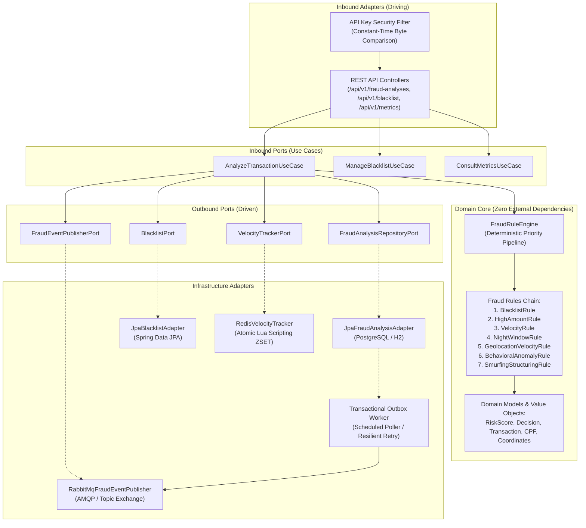
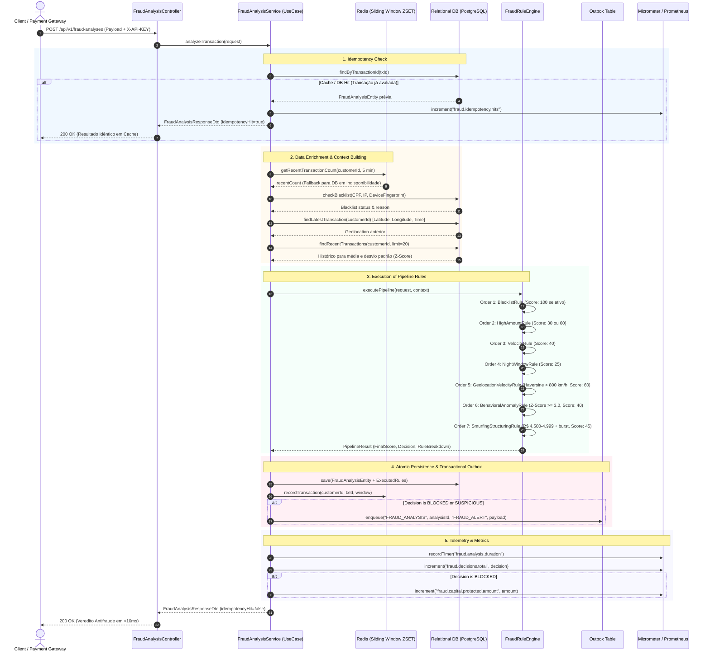

# 🏛️ Fraud Detection Engine — Architecture & System Design Document

Este documento consolida as decisões arquiteturais de nível **Senior/Staff Engineer**, padrões de resiliência distribuída, especificações da esteira de regras antifraude e os **Architectural Decision Records (ADRs)** do `fraud-detection-api`.

---

## 1. Visão Geral da Arquitetura (Hexagonal / Ports & Adapters)

O sistema foi concebido sob os princípios da **Arquitetura Hexagonal (Alistair Cockburn)**, isolando rigorosamente as regras de negócio de quaisquer acoplamentos a frameworks, bancos de dados relacionais, barramentos de mensageria ou caches de memória.



---

## 2. Fluxo de Execução da Avaliação de Risco (Sequence Diagram)

O diagrama abaixo detalha a jornada de uma requisição de análise antifraude, ilustrando a garantia de **idempotência**, **enriquecimento contextual**, **processamento em pipeline**, **gravação atômica via Outbox** e **emissão de telemetria Micrometer**:



---

## 3. Sliding Window Atômico via Redis ZSET (Lua Scripting)

### O Problema do Contador Fixo (Fixed Window Counter)
Abordagens ingênuas usando chaves `INCR` com TTL fixo sofrem do clássico **ataque de fronteira temporal (Border Burst)**:
- Se o limite é 3 requisições por janela de 5 minutos, um invasor pode disparar 3 requisições às `04:59` e mais 3 requisições às `05:01`. No contador fixo, ambas as janelas foram respeitadas, mas o cliente realizou **6 transações em 2 segundos**.

### A Solução: Sorted Set com Script Lua Atômico
A implementação em [`RedisVelocityTracker.java`](file:///src/main/java/com/felipedev/frauddetection/infrastructure/cache/RedisVelocityTracker.java) mantém uma janela deslizante contínua onde:
1. `Score` = Epoch Timestamp em milissegundos (`now`).
2. `Member` = `transactionId` único.
3. Um script Lua atômico executa no Redis sem disputa de lock:
   ```lua
   local key = KEYS[1]
   local now = tonumber(ARGV[1])
   local windowMillis = tonumber(ARGV[2])
   local txId = ARGV[3]
   local threshold = now - windowMillis
   
   -- Remove elementos com timestamp anterior ao início da janela
   redis.call('ZREMRANGEBYSCORE', key, '-inf', threshold)
   
   -- Se informado transactionId, insere o elemento atual
   if txId and txId ~= '' then
       redis.call('ZADD', key, now, txId)
   end
   
   -- Retorna a contagem exata no intervalo deslizante
   local count = redis.call('ZCARD', key)
   local ttl = math.ceil(windowMillis / 1000)
   redis.call('EXPIRE', key, math.max(ttl, 60))
   return count
   ```

```mermaid
gantt
    title Comparativo: Janela Fixa vs Janela Deslizante (Sliding Window)
    dateFormat  ss
    axisFormat  %S s

    section Fixed Window
    Janela 1 (3 tx max)    :done, 00, 30
    Janela 2 (3 tx max)    :done, 30, 60
    Burst Vulnerability    :crit, active, 28, 33

    section Sliding Window (ZSET)
    Janela Real Contínua [t - 300s, t] :active, 10, 50
    Detecção Imediata de Spike         :crit, done, 31, 33
```



---

## 4. Architectural Decision Records (ADRs)

### ADR-001: Adoção de Arquitetura Hexagonal (Ports & Adapters)
- **Status**: Aceito e Implementado.
- **Contexto**: A lógica central de detecção de fraudes precisava evoluir independentemente de detalhes de infraestrutura (Spring MVC, JPA Hibernate, drivers Redis ou RabbitMQ).
- **Decisão**: 
  - Declarar Casos de Uso (`AnalyzeTransactionUseCase`, `ManageBlacklistUseCase`, `ConsultMetricsUseCase`) no pacote `domain.port.in`.
  - Declarar Portas de Saída (`FraudAnalysisRepositoryPort`, `BlacklistPort`, `VelocityTrackerPort`, `FraudEventPublisherPort`) no pacote `domain.port.out`.
  - Isolar os adaptadores em `infrastructure.*`.
- **Tradeoffs**:
  - *Positivo*: Testabilidade pura em memória com 0ms de overhead; substituição de provedores de persistência sem tocar no núcleo do domínio.
  - *Negativo*: Leve aumento na quantidade de interfaces e camadas de mapeamento.

---

### ADR-002: Sliding Window via Redis ZSET + Scripting Lua
- **Status**: Aceito e Implementado.
- **Contexto**: Prevenir rajadas simultâneas de transações distribuídas (card testing e botnets) sob alta concorrência sem recorrer a travas pessimistas no banco de dados.
- **Decisão**: Executar a limpeza de scores obsoletos (`ZREMRANGEBYSCORE`), adição (`ZADD`) e contagem (`ZCARD`) em um único comando atômico executado no Redis via script Lua.
- **Tradeoffs**:
  - *Positivo*: Complexidade $O(\log N + M)$, zero race conditions em ambientes com múltiplas instâncias da API, sem overhead de distributed locking (Redlock).
  - *Negativo*: Consumo de memória ligeiramente maior no Redis do que um simples inteiro escalar. Compensado por TTL automático renovado no script.

---

### ADR-003: Transactional Outbox Pattern para Resiliência de Mensageria
- **Status**: Aceito e Implementado.
- **Contexto**: Ao identificar uma fraude (`BLOCKED` ou `SUSPICIOUS`), sistemas legados chamavam o broker de mensageria diretamente após o commit do banco. Caso a conexão de rede com o RabbitMQ falhasse, o evento era permanentemente perdido (inconsistência dual-write).
- **Decisão**: O evento de alerta é persistido na tabela `outbox_events` dentro da **mesma transação ACID** que grava o veredito da fraude. Um job em segundo plano (`OutboxPublisherJob`) despacha os eventos pendentes com retry exponencial e dead-lettering.
- **Tradeoffs**:
  - *Positivo*: Garantia matemática de entrega *at-least-once*; tolerância a partições de rede com o broker sem degradação do fluxo síncrono.
  - *Negativo*: Necessidade de idempotência no consumidor downstream (mitigada pelo envio explícito de `analysisId` e `transactionId`).

---

### ADR-004: Java 21 Virtual Threads (Project Loom)
- **Status**: Aceito e Implementado (`spring.threads.virtual.enabled: true`).
- **Contexto**: O motor antifraude realiza múltiplas chamadas de I/O em rede por transação (Redis, Banco de Dados, Outbox). O modelo clássico de 1 thread de SO por requisição (Thread-per-Request) esgota recursos de memória sob alta carga.
- **Decisão**: Ativar Virtual Threads gerenciadas pela JVM para todos os pools de despacho do Tomcat e tarefas assíncronas do Spring Boot.
- **Tradeoffs**:
  - *Positivo*: Suporta centenas de milhares de conexões concorrentes sem esgotar a stack de SO (consumo de poucos KBs por Virtual Thread); código síncrono limpo sem a complexidade reativa de WebFlux/Project Reactor.
  - *Negativo*: Requer atenção com seções críticas `synchronized` antigas (evitar *pinning* do carrier thread).

---

### ADR-005: Detecção de Impossible Travel via Fórmula de Haversine
- **Status**: Aceito e Implementado (`GeolocationVelocityRule`).
- **Contexto**: Fraudes de apropriação de conta (Account Takeover - ATO) envolvem transações originadas em posições geográficas incompatíveis com a física de viagens humanas.
- **Decisão**: Calcular a distância geodésica em quilômetros sobre a superfície esférica da Terra ($R = 6371\text{ km}$):
  $$a = \sin^2\left(\frac{\Delta\phi}{2}\right) + \cos(\phi_1)\cos(\phi_2)\sin^2\left(\frac{\Delta\lambda}{2}\right)$$
  $$d = 2R \cdot \text{atan2}(\sqrt{a}, \sqrt{1-a})$$
  Se a velocidade requerida $v = \frac{d}{\Delta t}$ ultrapassar $800\text{ km/h}$ para distâncias superiores a $50\text{ km}$, o motor pontua criticamente (+60 pontos).
- **Tradeoffs**:
  - *Positivo*: Identificação de acessos simultâneos por botnets e proxies remotos; sem necessidade de consultar APIs externas de geolocalização por IP a cada transação.
  - *Negativo*: Falsos positivos em casos raros de tunelamento corporativo VPN; mitigado pelo limiar mínimo de distância e pontuação calibrada.

---

### ADR-006: Análise de Anomalia Comportamental via Z-Score Estatístico
- **Status**: Aceito e Implementado (`BehavioralAnomalyRule`).
- **Contexto**: Valores absolutos fixos não diferenciam adequadamente um cliente de alta renda de um cliente com tíquete médio baixo.
- **Decisão**: Calcular a pontuação padronizada $Z$ em relação ao histórico de consumo do cliente:
  $$Z = \frac{x - \mu}{\sigma}$$
  Onde $x$ é o valor da transação atual, $\mu$ é a média aritmética das últimas transações do cliente, e $\sigma$ é o desvio padrão amostral:
  $$\sigma = \sqrt{\frac{1}{N-1} \sum_{i=1}^N (x_i - \mu)^2}$$
  Quando $Z \ge 3.0$ (valor superior a 3 desvios padrão acima da média habitual), dispara penalidade de risco (+40 pontos).
- **Tradeoffs**:
  - *Positivo*: Regra adaptativa hiper-personalizada; se ajusta dinamicamente ao comportamento de cada portador sem regras manuais engessadas.
  - *Negativo*: Requer histórico mínimo de transações para estabilização ($N \ge 3$); enquanto o histórico não atinge o volume, a regra é suspensa sem gerar ruído.

---

## 5. Matriz de Resiliência & Degradação Graciosa

| Componente | Modo de Falha | Estratégia de Mitigação | Comportamento do Sistema |
| :--- | :--- | :--- | :--- |
| **Redis** | Timeout / Crash | Fallback transparente em `RedisVelocityTracker` | Realiza query de agregação indexada no PostgreSQL (`countByCustomerIdAndAnalyzedAtAfter`) |
| **RabbitMQ** | Broker Down / Partição | Gravação em tabela `outbox_events` (ACID) | A transação do cliente é aprovada/reprovada normalmente; alerta é despachado quando o broker restabelecer |
| **Banco Relacional** | Deadlock / Contenção | Idempotência atômica e índices cobrindo `transaction_id` e `customer_id` | Transação abortada com rollback limpo e resposta padronizada RFC 7807 |
| **Cliente Duplicado** | Reenvio de payload idêntico | Verificação de idempotência em O(1) indexada | Retorna análise original com flag `idempotencyHit: true` sem reprocessar regras |

---

## 6. Telemetria e Métricas Prometheus

As métricas personalizadas registradas via Micrometer estão expostas em `/actuator/prometheus`:

- `fraud.analysis.duration` (**Timer**): Latência fim-a-fim da avaliação, tagueada por veredito (`decision=APPROVED|SUSPICIOUS|BLOCKED`).
- `fraud.decisions.total` (**Counter**): Volume total de transações avaliadas por veredito.
- `fraud.capital.protected.amount` (**Counter**): Somatório financeiro (BRL) do volume financeiro fraudulento evitado por bloqueios.
- `fraud.idempotency.hits` (**Counter**): Contabilização de requisições idempotentes interceptadas sem recalcular regras.
